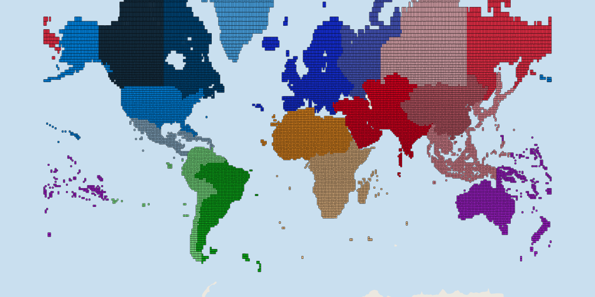

# XEarthLayer Regional Scenery Packages

This repository hosts regional scenery packages for [XEarthLayer](https://github.com/samsoir/xearthlayer).

## Coverage Map



*Each continent has its own hue, with a different shade for each region: North America in azure, South America in green, Europe in ultramarine, Africa in amber, Asia in red and pink, and Oceania in violet. [View interactive map](coverage.geojson) for exact tile boundaries.*

## Available Regions

| Region | Code | Version | Tiles | Ortho Size | Overlay Size |
|--------|------|---------|-------|------------|--------------|
| Africa: North | AF-NORTH | 0.5.0 | 1,453 | 6.7 GB | 558.5 MB |
| Africa: South | AF-SOUTH | 0.5.0 | 1,471 | 8.5 GB | 622.4 MB |
| Asia: Japan, Korea and Southeast Asia | AS-ASIA-PACIFIC | 0.5.0 | 1,071 | 10.4 GB | 1.2 GB |
| Asia: China and Mongolia | AS-CHINA-MONGOLIA | 0.5.0 | 1,270 | 17.8 GB | 679.1 MB |
| Asia: India, the Middle East and the Himalaya | AS-INDIA-MIDDLE-EAST-HIMALAYAN | 0.5.0 | 1,769 | 15.5 GB | 1.3 GB |
| Asia: Central Russia | AS-RUSSIA-CENTRAL | 0.5.0 | 1,492 | 4.5 GB | 235.0 MB |
| Asia: Russian Far East | AS-RUSSIA-EAST | 0.5.0 | 1,211 | 6.3 GB | 137.0 MB |
| Europe: East | EU-EAST | 0.5.0 | 804 | 3.4 GB | 330.4 MB |
| Europe: West | EU-WEST | 0.5.0 | 1,235 | 14.2 GB | 2.0 GB |
| North America: Eastern Canada | NA-CANADA-EAST | 0.5.0 | 1,132 | 13.0 GB | 282.5 MB |
| North America: Western Canada | NA-CANADA-WEST | 0.5.0 | 1,155 | 10.0 GB | 248.1 MB |
| North America: Greenland | NA-GREENLAND | 0.5.0 | 807 | 843.2 MB | 2.6 MB |
| North America: Mexico, Central America and the Caribbean | NA-MEXICO-CENTRAL | 0.5.0 | 435 | 4.1 GB | 409.2 MB |
| North America: United States, Bermuda and the Bahamas | NA-USA-BERMUDA-BAHAMAS | 0.5.0 | 1,416 | 12.6 GB | 1.5 GB |
| Oceania: Australia, New Zealand and the Pacific | OC-AUSTRALIA-NZ-PACIFIC | 0.5.0 | 1,381 | 5.3 GB | 225.9 MB |
| South America: East | SA-EAST | 0.5.0 | 1,206 | 8.1 GB | 698.0 MB |
| South America: West | SA-WEST | 0.5.0 | 705 | 8.9 GB | 342.8 MB |

The world scenery has been rebuilt into smaller regions, covering every continent except Antarctica. All of them are on the staging channel for now. They require XEarthLayer 0.5.0 or later. Tiles along the border between two regions are included in both, so each region is complete on its own.

## Installation

```bash
# The package library URL. This is the default, so it is only needed if you
# have pointed XEarthLayer somewhere else (for example at the staging channel)
xearthlayer config set packages.library_url https://xearthlayer.app/packages/xearthlayer_package_library.txt

# Install a region
xearthlayer packages install na-usa-bermuda-bahamas --type ortho
xearthlayer packages install na-usa-bermuda-bahamas --type overlay
```

### Staging Channel

Regions under test are published on the `staging` branch. To install them, point at the staging library index:

```bash
xearthlayer packages install eu-west \
  --library-url https://raw.githubusercontent.com/samsoir/xearthlayer-regional-scenery/staging/xearthlayer_package_library.txt
```

## Package Downloads

Packages are distributed as GitHub Release assets. The package manager handles downloading automatically.

For manual downloads, see the [Releases](https://github.com/samsoir/xearthlayer-regional-scenery/releases) page.

## Coverage Details

### Africa: North (AF-NORTH) v0.5.0 (staging)

North and West Africa: Morocco, Western Sahara, Algeria, Tunisia, Libya, Egypt, Sudan, Chad, the Sahel and the West African coast from Mauritania to Nigeria, with the Canary Islands, Madeira and Cabo Verde.

### Africa: South (AF-SOUTH) v0.5.0 (staging)

Central, East and Southern Africa from Cameroon, South Sudan, Ethiopia and the Horn of Africa to South Africa, with Madagascar, the Indian Ocean islands including the Seychelles, Mauritius and Reunion, and the South Atlantic islands of St Helena, Ascension, Tristan da Cunha, Gough and Bouvet.

### Asia: Japan, Korea and Southeast Asia (AS-ASIA-PACIFIC) v0.5.0 (staging)

Japan including the Ryukyu and Ogasawara Islands, the southern Kuril Islands, North and South Korea, Taiwan, Myanmar, Thailand, Laos, Cambodia, Vietnam, Malaysia, Singapore, Brunei, Indonesia, Timor-Leste, the Philippines, Palau, Guam and the Northern Mariana Islands.

### Asia: China and Mongolia (AS-CHINA-MONGOLIA) v0.5.0 (staging)

China including Hainan, Hong Kong and Macau, and Mongolia.

### Asia: India, the Middle East and the Himalaya (AS-INDIA-MIDDLE-EAST-HIMALAYAN) v0.5.0 (staging)

The Arabian Peninsula, the Levant, Cyprus, Anatolia, the Caucasus, Iran, Iraq, Central Asia including Kazakhstan, Afghanistan, Pakistan, India, Nepal, Bhutan, Bangladesh, Sri Lanka and the Maldives.

### Asia: Central Russia (AS-RUSSIA-CENTRAL) v0.5.0 (staging)

Siberia from the Urals to Lake Baikal and Transbaikalia, including Franz Josef Land, Severnaya Zemlya and the Taymyr Peninsula.

### Asia: Russian Far East (AS-RUSSIA-EAST) v0.5.0 (staging)

The Russian Far East from Yakutia to the Bering Strait, including Chukotka, Kamchatka, the northern Kuril Islands, Sakhalin, Primorye and Wrangel Island.

### Europe: East (EU-EAST) v0.5.0 (staging)

European Russia west of the Urals, from St Petersburg and the Kola Peninsula to the Volga and the northern Caucasus, including Novaya Zemlya.

### Europe: West (EU-WEST) v0.5.0 (staging)

Europe west of Russia: the British Isles, Iceland, the Faroe Islands, Scandinavia including Svalbard and Jan Mayen, Finland, the Baltic states, Poland, Belarus, Ukraine, Moldova, Western and Central Europe, Iberia with the Azores, the Mediterranean islands, the Balkans, Greece and European Turkey.

### North America: Eastern Canada (NA-CANADA-EAST) v0.5.0 (staging)

Canada east of 95 degrees west: eastern Manitoba, Ontario, Quebec, the Atlantic provinces including Sable Island, Newfoundland and Labrador, eastern Nunavut and the eastern Arctic Archipelago, with Saint Pierre and Miquelon.

### North America: Western Canada (NA-CANADA-WEST) v0.5.0 (staging)

Canada west of 95 degrees west: British Columbia including Haida Gwaii, Alberta, Saskatchewan, western Manitoba, Yukon, the Northwest Territories and western Nunavut, with the western Arctic Archipelago.

### North America: Greenland (NA-GREENLAND) v0.5.0 (staging)

Greenland.

### North America: Mexico, Central America and the Caribbean (NA-MEXICO-CENTRAL) v0.5.0 (staging)

Mexico including the Revillagigedo Islands and Clipperton, Guatemala, Belize, Honduras, El Salvador, Nicaragua, Costa Rica, Panama, and the Caribbean from Cuba and the Cayman Islands through Hispaniola, Puerto Rico and the Lesser Antilles.

### North America: United States, Bermuda and the Bahamas (NA-USA-BERMUDA-BAHAMAS) v0.5.0 (staging)

The contiguous United States, Alaska including the Aleutian and Pribilof Islands, Hawaii including the Northwestern Hawaiian Islands and Midway, Bermuda, the Bahamas and the Turks and Caicos Islands.

### Oceania: Australia, New Zealand and the Pacific (OC-AUSTRALIA-NZ-PACIFIC) v0.5.0 (staging)

Australia including Lord Howe, Norfolk and Macquarie Islands, New Zealand including the Chatham, Kermadec and subantarctic islands, Papua New Guinea, Melanesia, Micronesia and Polynesia from the Marshall Islands and Kiribati to Fiji, Samoa, Tonga, the Cook Islands and French Polynesia.

### South America: East (SA-EAST) v0.5.0 (staging)

Brazil including Fernando de Noronha, Argentina, Paraguay, Uruguay, the Falkland Islands, South Georgia and the South Sandwich Islands.

### South America: West (SA-WEST) v0.5.0 (staging)

Colombia, Venezuela, Ecuador including the Galapagos Islands, Peru, Bolivia, Chile including Easter Island and the Juan Fernandez Islands, the Guianas, Trinidad and Tobago, Aruba, Curacao and Bonaire, and the Pitcairn Islands.

## Website Sync

When the library index is updated, changes are automatically synced to [xearthlayer.app](https://xearthlayer.app):

1. Push to `main` with changes to `xearthlayer_package_library.txt`
2. `notify-website.yml` triggers `repository_dispatch` to the website repo
3. Website fetches updated library and regenerates package documentation
4. Site deploys automatically

### Required Setup

The `WEBSITE_DISPATCH_TOKEN` secret must be configured with a fine-grained PAT that has:
- **Repository access:** `samsoir/xearthlayer-website`
- **Permissions:** Contents (read/write)
- **Expiration:** 90 days (maximum for fine-grained tokens)

Set a calendar reminder to refresh the token before expiration. The daily cron fallback ensures syncs still occur if the token expires.

## License

Scenery data generated from publicly available satellite imagery.
