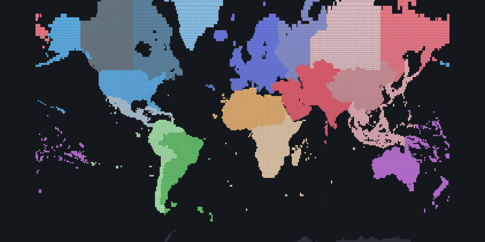
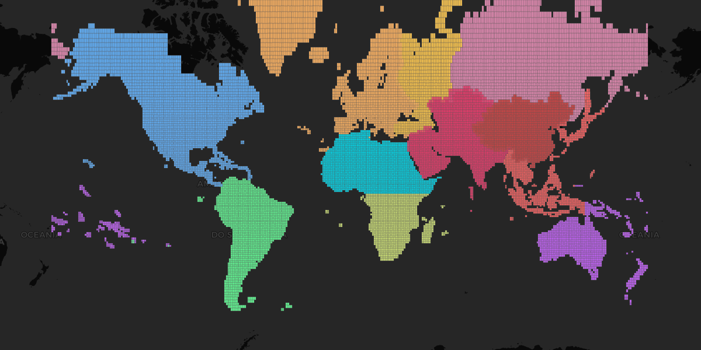

# XEarthLayer Regional Scenery Packages

This repository hosts regional scenery packages for [XEarthLayer](https://github.com/samsoir/xearthlayer).

The scenery is organised into library generations. This page describes generation v2, the current world, for XEarthLayer 0.5 and later. Clients older than 0.5 read generation v1, described [at the end of this page](#generation-v1-xearthlayer-older-than-05).

## Coverage Map



*Each continent has its own hue, and regions within it vary in shade: North America in azure, South America in green, Europe in blue, Africa in orange, Asia in red and Oceania in purple. [View interactive map](v2/coverage.geojson) for exact tile boundaries.*

## Available Regions

| Region | Code | Version | Tiles | Ortho Size | Overlay Size |
|--------|------|---------|-------|------------|--------------|
| Africa: North | AF-NORTH | 0.5.1 | 1,453 | 6.7 GB | 0.6 GB |
| Africa: South | AF-SOUTH | 0.5.1 | 1,471 | 8.5 GB | 0.6 GB |
| Asia: Japan, Korea and Southeast Asia | AS-ASIA-PACIFIC | 0.5.1 | 1,071 | 10.4 GB | 1.2 GB |
| Asia: China and Mongolia | AS-CHINA-MONGOLIA | 0.5.1 | 1,270 | 17.9 GB | 0.7 GB |
| Asia: India, the Middle East and the Himalaya | AS-INDIA-MIDDLE-EAST-HIMALAYAN | 0.5.1 | 1,769 | 15.5 GB | 1.3 GB |
| Asia: Central Russia | AS-RUSSIA-CENTRAL | 0.5.1 | 1,492 | 4.5 GB | 0.2 GB |
| Asia: Russian Far East | AS-RUSSIA-EAST | 0.5.1 | 1,211 | 6.3 GB | 0.1 GB |
| Europe: East | EU-EAST | 0.5.1 | 804 | 3.4 GB | 0.3 GB |
| Europe: West | EU-WEST | 0.5.1 | 1,235 | 14.2 GB | 2.0 GB |
| North America: Eastern Canada | NA-CANADA-EAST | 0.5.1 | 1,132 | 12.9 GB | 0.3 GB |
| North America: Western Canada | NA-CANADA-WEST | 0.5.1 | 1,155 | 10.0 GB | 0.2 GB |
| North America: Greenland | NA-GREENLAND | 0.5.1 | 807 | 0.8 GB | 3 MB |
| North America: Mexico, Central America and the Caribbean | NA-MEXICO-CENTRAL | 0.5.1 | 435 | 4.1 GB | 0.4 GB |
| North America: United States, Bermuda and the Bahamas | NA-USA-BERMUDA-BAHAMAS | 0.5.1 | 1,416 | 12.6 GB | 1.5 GB |
| Oceania: Australia, New Zealand and the Pacific | OC-AUSTRALIA-NZ-PACIFIC | 0.5.1 | 1,381 | 5.3 GB | 0.2 GB |
| South America: East | SA-EAST | 0.5.1 | 1,206 | 8.1 GB | 0.7 GB |
| South America: West | SA-WEST | 0.5.1 | 705 | 8.9 GB | 0.3 GB |

Sizes are download sizes. Every region includes high resolution scenery for ICAO airports, ZL17 within a 1 km radius of each airport.

## Installation

XEarthLayer 0.5 and later read this library by default, so there is nothing to configure. Install the ortho and overlay package of a region:

```bash
xearthlayer packages install eu-west --type ortho
xearthlayer packages install eu-west --type overlay
```

A code may be the start of one to select a group of regions, such as `na-canada`. Running `xearthlayer packages` with no arguments opens the package manager.

The library is at `https://xearthlayer.app/packages/v2/xearthlayer_package_library.txt`.

## Package Downloads

Packages are distributed as GitHub Release assets. The package manager handles downloading automatically.

For manual downloads, see the [Releases](https://github.com/samsoir/xearthlayer-regional-scenery/releases) page.

## Coverage Details

### Africa: North (AF-NORTH)

North and West Africa: Morocco, Western Sahara, Algeria, Tunisia, Libya, Egypt, Sudan, Chad, the Sahel and the West African coast from Mauritania to Nigeria, with the Canary Islands, Madeira and Cabo Verde.

### Africa: South (AF-SOUTH)

Central, East and Southern Africa from Cameroon, South Sudan, Ethiopia and the Horn of Africa to South Africa, with Madagascar, the Indian Ocean islands including the Seychelles, Mauritius and Reunion, and the South Atlantic islands of St Helena, Ascension, Tristan da Cunha, Gough and Bouvet.

### Asia: Japan, Korea and Southeast Asia (AS-ASIA-PACIFIC)

Japan including the Ryukyu and Ogasawara Islands, the southern Kuril Islands, North and South Korea, Taiwan, Myanmar, Thailand, Laos, Cambodia, Vietnam, Malaysia, Singapore, Brunei, Indonesia, Timor-Leste, the Philippines, Palau, Guam and the Northern Mariana Islands.

### Asia: China and Mongolia (AS-CHINA-MONGOLIA)

China including Hainan, Hong Kong and Macau, and Mongolia.

### Asia: India, the Middle East and the Himalaya (AS-INDIA-MIDDLE-EAST-HIMALAYAN)

The Arabian Peninsula, the Levant, Cyprus, Anatolia, the Caucasus, Iran, Iraq, Central Asia including Kazakhstan, Afghanistan, Pakistan, India, Nepal, Bhutan, Bangladesh, Sri Lanka and the Maldives.

### Asia: Central Russia (AS-RUSSIA-CENTRAL)

Siberia from the Urals to Lake Baikal and Transbaikalia, including Franz Josef Land, Severnaya Zemlya and the Taymyr Peninsula.

### Asia: Russian Far East (AS-RUSSIA-EAST)

The Russian Far East from Yakutia to the Bering Strait, including Chukotka, Kamchatka, the northern Kuril Islands, Sakhalin, Primorye and Wrangel Island.

### Europe: East (EU-EAST)

European Russia west of the Urals, from St Petersburg and the Kola Peninsula to the Volga and the northern Caucasus, including Novaya Zemlya.

### Europe: West (EU-WEST)

Europe west of Russia: the British Isles, Iceland, the Faroe Islands, Scandinavia including Svalbard and Jan Mayen, Finland, the Baltic states, Poland, Belarus, Ukraine, Moldova, Western and Central Europe, Iberia with the Azores, the Mediterranean islands, the Balkans, Greece and European Turkey.

### North America: Eastern Canada (NA-CANADA-EAST)

Canada east of 95 degrees west: eastern Manitoba, Ontario, Quebec, the Atlantic provinces including Sable Island, Newfoundland and Labrador, eastern Nunavut and the eastern Arctic Archipelago, with Saint Pierre and Miquelon.

### North America: Western Canada (NA-CANADA-WEST)

Canada west of 95 degrees west: British Columbia including Haida Gwaii, Alberta, Saskatchewan, western Manitoba, Yukon, the Northwest Territories and western Nunavut, with the western Arctic Archipelago.

### North America: Greenland (NA-GREENLAND)

Greenland.

### North America: Mexico, Central America and the Caribbean (NA-MEXICO-CENTRAL)

Mexico including the Revillagigedo Islands and Clipperton, Guatemala, Belize, Honduras, El Salvador, Nicaragua, Costa Rica, Panama, and the Caribbean from Cuba and the Cayman Islands through Hispaniola, Puerto Rico and the Lesser Antilles.

### North America: United States, Bermuda and the Bahamas (NA-USA-BERMUDA-BAHAMAS)

The contiguous United States, Alaska including the Aleutian and Pribilof Islands, Hawaii including the Northwestern Hawaiian Islands and Midway, Bermuda, the Bahamas and the Turks and Caicos Islands.

### Oceania: Australia, New Zealand and the Pacific (OC-AUSTRALIA-NZ-PACIFIC)

Australia including Lord Howe, Norfolk and Macquarie Islands, New Zealand including the Chatham, Kermadec and subantarctic islands, Papua New Guinea, Melanesia, Micronesia and Polynesia from the Marshall Islands and Kiribati to Fiji, Samoa, Tonga, the Cook Islands and French Polynesia.

### South America: East (SA-EAST)

Brazil including Fernando de Noronha, Argentina, Paraguay, Uruguay, the Falkland Islands, South Georgia and the South Sandwich Islands.

### South America: West (SA-WEST)

Colombia, Venezuela, Ecuador including the Galapagos Islands, Peru, Bolivia, Chile including Easter Island and the Juan Fernandez Islands, the Guianas, Trinidad and Tobago, Aruba, Curacao and Bonaire, and the Pitcairn Islands.

## Website Sync

When a library index is updated, changes are automatically synced to [xearthlayer.app](https://xearthlayer.app):

1. Push to `main` with changes to a generation's library index, region metadata or coverage map (`v*/`)
2. `notify-website.yml` triggers `repository_dispatch` to the website repo
3. Website fetches updated libraries and regenerates package documentation
4. Site deploys automatically

### Required Setup

The `WEBSITE_DISPATCH_TOKEN` secret must be configured with a fine-grained PAT that has:
- **Repository access:** `samsoir/xearthlayer-website`
- **Permissions:** Contents (read/write)
- **Expiration:** 90 days (maximum for fine-grained tokens)

Set a calendar reminder to refresh the token before expiration. The daily cron fallback ensures syncs still occur if the token expires.

## Generation v1 (XEarthLayer older than 0.5)

The library at the repository root is frozen for clients older than 0.5, which cannot read anything else. The same library is also in [`v1/`](v1/). Its packages will not gain new versions.

<details>
<summary>Generation v1 coverage and regions</summary>



*NA tiles in blue, EU tiles in orange, EU2 tiles in tangerine, SA tiles in green, OC tiles in purple, AS1 tiles in firebrick, AS2 tiles in crimson, AS3 tiles in red, AS4 tiles in palevioletred, AF1 tiles in cyan, AF2 tiles in yellowish-green. [View interactive map](v1/coverage.geojson) for exact tile boundaries.*

| Region | Code | Version | Tiles | Ortho Size | Overlay Size |
|--------|------|---------|-------|------------|--------------|
| Africa - Part 1 | AF1 | 0.1.0 | 1,718 | 10.5 GB | 722.6 MB |
| Africa - Part 2 | AF2 | 0.1.0 | 1,058 | 7.9 GB | 541 MB |
| Asia - Part 1 | AS1 | 0.1.0 | 1,264 | 21.3 GB | 728 MB |
| Asia - Part 2 | AS2 | 0.1.0 | 1,615 | 17.3 GB | 1.3 GB |
| Asia - Part 3 | AS3 | 0.1.0 | 901 | 13.3 GB | 1.3 GB |
| Asia - Part 4 | AS4 | 0.1.0 | 2,705 | 23.1 GB | 408.7 MB |
| Europe | EU | 0.1.1 | 1,995 | 29.8 GB | 2.1 GB |
| Europe - Part 2 | EU2 | 0.1.0 | 883 | 11.1 GB | 578.9 MB |
| North America | NA | 0.2.3 | 2,860 | 72.9 GB | 2.5 GB |
| Oceania | OC | 0.2.0 | 1,276 | 8.7 GB | 239 MB |
| South America | SA | 0.2.0 | 1,734 | 26.5 GB | 1.1 GB |

### Europe (EU) v0.1.1

Expanded coverage including:
- United Kingdom & Ireland
- France, Germany, Benelux
- Spain, Portugal
- Italy, Switzerland, Austria, Alps
- Scandinavia (Norway, Sweden, Finland, Denmark)
- Iceland
- Eastern Europe (Poland, Czech Republic, Hungary, Balkans)
- Mediterranean (Greece, Turkey, Cyprus)
- Baltic States

### Europe - Part 2 (EU2) v0.1.0

Initial release covering:
- **Eastern Europe** - Bulgaria, Romania, Moldova, Ukraine, Belarus
- **Baltic States** - Estonia, Latvia, Lithuania (eastern coverage)
- **Scandinavia** - Finland, Sweden (east), Norway (north and east)
- **Eastern Mediterranean** - Turkey, Cyprus
- **Caucasus** - Georgia, Armenia, Azerbaijan
- **European Russia** - Moscow, St Petersburg, Volga region, North Caucasus
- **Western Siberia** - extending to the Ural Mountains and slightly beyond
- **Russian Arctic** - Kola, Kanin, Yamal, Gydan peninsulas, Novaya Zemlya

Geographic extent: +35° to +77° latitude, +026° to +068° longitude

### North America (NA) v0.2.3

Expanded coverage including:
- **Hawaii** - Main islands
- **Alaska** - Major areas
- **Canada** - Partial coverage
- **Contiguous 48 States** - Partial coverage
- **Caribbean** - Islands and coastal areas
- **Mexico** - Coverage areas

Geographic extent: +07° to +71° latitude, -078° to -163° longitude

### Oceania (OC) v0.2.0

Expanded coverage including:
- **Australia** - Complete mainland and Tasmania
- **New Zealand** - North and South Islands
- **Papua New Guinea** - Comprehensive coverage
- **Fiji** - Main islands
- **French Polynesia** - Tahiti and surrounding islands
- **Vanuatu** - Island chain coverage
- **Solomon Islands** - Major islands

Geographic extent: -48° to +02° latitude, +112° to -149° longitude

### Africa - Part 1 (AF1) v0.1.0

Initial release covering:
- **North Africa** - Morocco, Algeria, Tunisia, Libya, Egypt, Western Sahara
- **Sahel** - Mauritania, Mali, Niger, Chad, Sudan, South Sudan
- **West Africa** - Senegal, Gambia, Guinea, Sierra Leone, Liberia, Ivory Coast, Ghana, Benin, Nigeria
- **Central/East Africa** - Cameroon, Central African Republic, Ethiopia, Somalia, Djibouti

Geographic extent: +03° to +37° latitude, -018° to +054° longitude

### Africa - Part 2 (AF2) v0.1.0

Initial release covering:
- **Southern Africa** - South Africa, Namibia, Botswana, Zimbabwe, Zambia, Malawi
- **East Africa** - Tanzania, Kenya, Uganda, Rwanda, Burundi, Ethiopia (partial)
- **Central Africa** - DRC, Angola, Congo, Gabon, Cameroon (partial)
- **Islands** - Madagascar, Mauritius, Seychelles, Comoros, Réunion

Geographic extent: -35° to +05° latitude, +08° to +58° longitude

### Asia - Part 1 (AS1) v0.1.0

Initial release covering:
- **China** - Broad coverage of mainland China, including Xinjiang, Tibet, Inner Mongolia, and Hainan
- **Mongolia** - Full country coverage
- **Hong Kong** and **Macau** - Special Administrative Regions

Geographic extent: +18° to +53° latitude, +073° to +134° longitude

### Asia - Part 2 (AS2) v0.1.0

Initial release covering:
- **Middle East** - Saudi Arabia, UAE, Oman, Yemen, Qatar, Bahrain, Kuwait, Iran, Iraq, Syria, Jordan, Israel, Lebanon, eastern Turkey
- **South Asia** - Pakistan, India, Nepal, Bhutan, Bangladesh, Sri Lanka, Maldives
- **Central Asia** - Afghanistan, Kazakhstan, Uzbekistan, Turkmenistan, Kyrgyzstan, Tajikistan
- **Northern Asia** - Western China (Xinjiang, Tibet), western Mongolia, southern Russian border regions
- **Indian Ocean Islands** - Chagos Archipelago, Lakshadweep, and other coastal/offshore islands

Geographic extent: -08° to +55° latitude, +034° to +097° longitude

### Asia - Part 3 (AS3) v0.1.0

Initial release covering:
- **South East Asia** - Indonesia, Malaysia, Singapore, Philippines, Vietnam, Thailand, Cambodia, Myanmar
- **East Asia** - Japan (all main islands), South Korea, Taiwan
- **Eastern Russia** - Sakhalin, Kuril Islands

Geographic extent: -13° to +54° latitude, +96° to +152° longitude

### Asia - Part 4 (AS4) v0.1.0

Initial release covering Russia east of the Ural Mountains:
- **Western Siberia** - extending east from the Urals (Tyumen, Omsk, Tomsk, Novosibirsk regions)
- **Central Siberia** - Krasnoyarsk Krai, Tuva, Khakassia, Irkutsk Oblast, Buryatia
- **Eastern Siberia / Yakutia** - Sakha Republic, Yakutsk, Lake Baikal area
- **Russian Far East** - Khabarovsk Krai, Primorsky Krai (Vladivostok), Amur Oblast, Magadan
- **Kamchatka Peninsula** - Petropavlovsk-Kamchatsky and the volcanic chain
- **Chukotka Peninsula** - including territory across the antimeridian
- **Russian Arctic Islands** - Severnaya Zemlya, New Siberian Islands, Wrangel Island, Franz Josef Land area

Geographic extent: +42° to +81° latitude, +044° east through +180° / -180° to -169° west

### South America (SA) v0.2.0

Complete continental coverage including:
- **Brazil** - Comprehensive coverage
- **Argentina** - Full coverage including Patagonia
- **Chile** - Full coverage from Atacama to Tierra del Fuego
- **Peru, Bolivia, Ecuador, Colombia, Venezuela** - Complete coverage
- **Paraguay, Uruguay, Guyana, Suriname, French Guiana** - Complete coverage
- **Falkland Islands** - Included
- **Offshore Islands** - Galápagos and other coastal islands

Geographic extent: -56° to +00° latitude (Equator to Cape Horn)

</details>

## License

Scenery data generated from publicly available satellite imagery.
